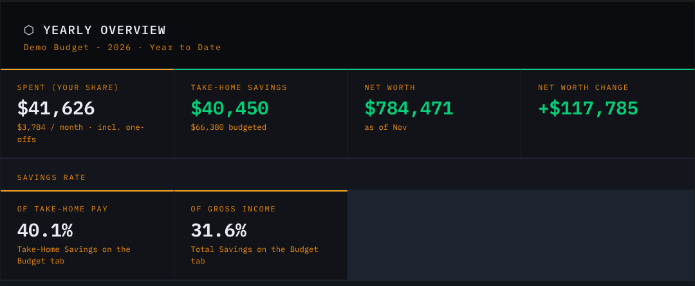
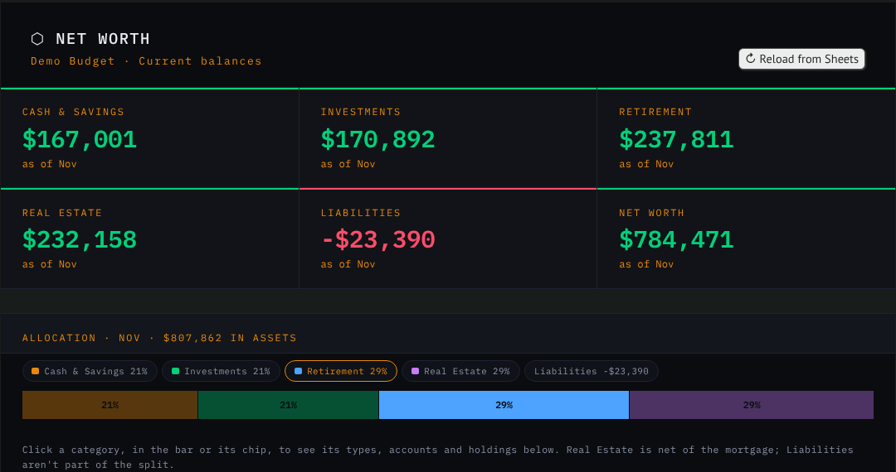
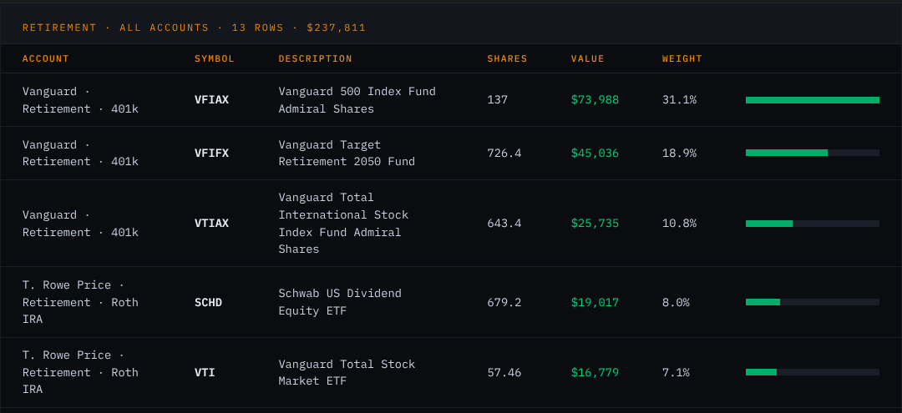

<!-- _paginate: false -->

FinDash · A live demo

# Personal finance on autopilot

Splitwise and SimpleFIN feed a Google Sheet. Two dashboards read it live.

Everything shown here is made-up data.

---
<!-- _class: alt -->

The problem

## Where did the money go?

<b>Spending is scattered</b>Cards, cash and shared bills with a partner, each in a different place.

<b>Balances are everywhere</b>Checking, savings, brokerages, a 401(k) and an IRA, each with its own login.

<b>Spreadsheets go stale</b>A budget that needs typing is a budget that stops being updated by March.

---

Architecture

## Two feeds, one sheet, two dashboards

---
<!-- _class: alt -->

The feeds

## Nothing typed by hand

<b>Spending</b>Linked cards sync into Splitwise. Splits and categories are fixed there once, and the sheet copies them.

<b>Balances</b>Every linked bank, card, brokerage and retirement account, plus the securities each one holds.

<b>The record</b>A yearly workbook with formulas anyone can read, and a ledger that grows run over run.

---

Live demo · 1 of 2

## Yearly Overview

Spent, saved and net worth so far · savings rate · spending by month and what moved · runway and dividends

---
<!-- _class: alt -->

Live demo · 2 of 2

## Net Worth

Cash, investments, retirement and real estate · click a category to drill in

---

Live demo · drill-down

## Down to the fund

Pick an account or see them all · each account's holdings add up to its balance

---
<!-- _class: alt -->

The budget template

## One sheet for the household

<b>Shared</b>Each partner has their own pay and expense log. Budget and Net Worth add both up.

<b>Auditable</b>Every total is a formula you can click into.

<b>Migration</b>A script moves an old single-person budget onto the template.

<b>Generated</b>The workbook is built from code, so a new year is one command.

---
<!-- _class: alt -->

Privacy by design

## Data stays out of the repo

<b>Code</b>Names, account numbers and balances live in secrets and the sheet, never in code.

<b>Access</b>One password and a signed cookie that expires daily. No password, no start.

<b>Sheets</b>A service account sees only the sheets shared with it.

<b>Logs</b>Public workflow logs show counts and tab names, never accounts or amounts.

